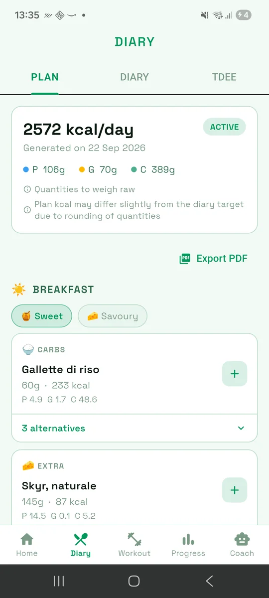
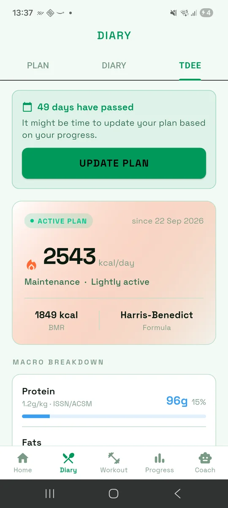
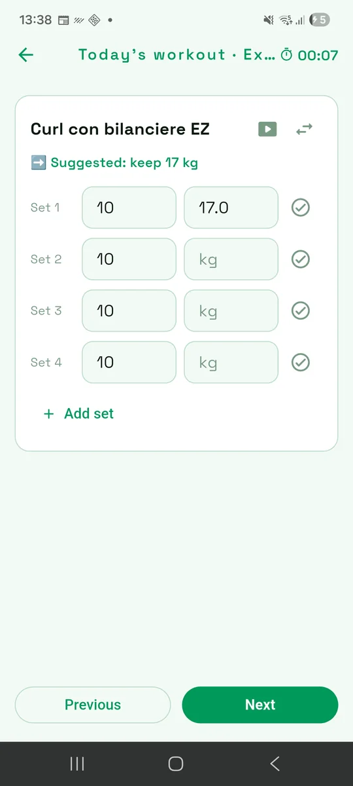
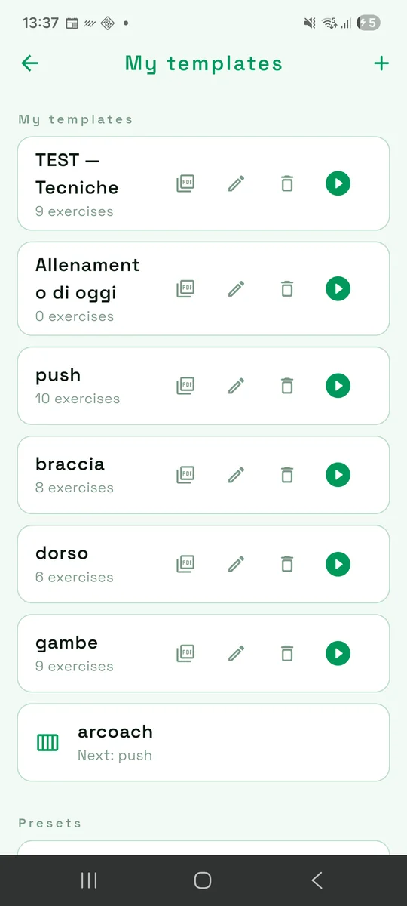
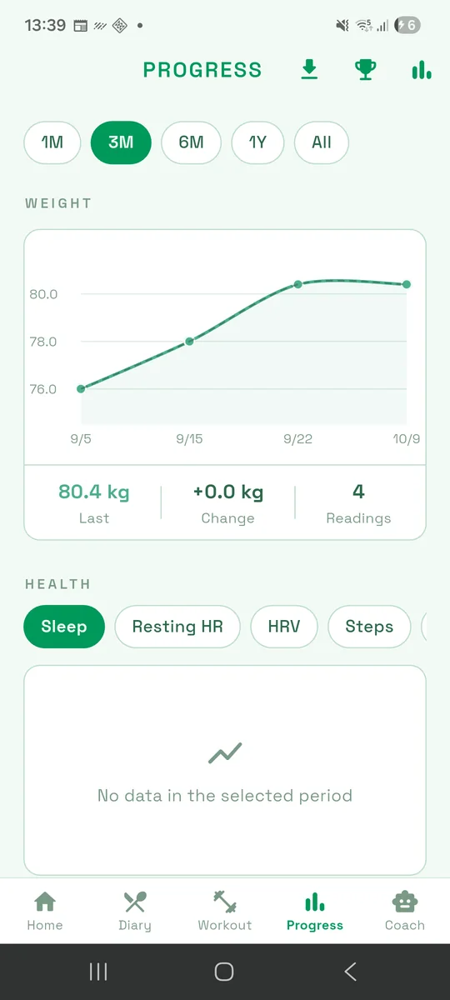
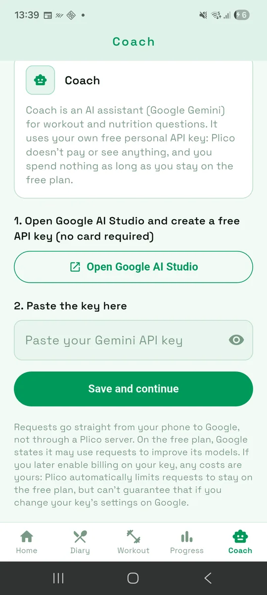

<div align="center">


# Plico

**Open source workout & nutrition tracker for Android.**<br>
Guided workouts, meal plans, calorie and macro tracking, and an optional AI coach.<br>
No account. No ads. No analytics. Your data stays on your phone.

[](LICENSE)
[](#build-it-yourself)
[](https://flutter.dev)

[**Website**](https://mariogiordano96.github.io/plico/) · [**Download the APK**](https://github.com/mariogiordano96/plico/releases/latest) · [**Build it yourself**](#build-it-yourself)

</div>

<br>

<table align="center">
  <tr>
    <td align="center" width="33%"><picture><source media="(prefers-color-scheme: dark)" srcset="docs/screenshots/02-meal-plan-dark.webp"></picture><br><sub><b>Meal plan</b></sub></td>
    <td align="center" width="33%"><picture><source media="(prefers-color-scheme: dark)" srcset="docs/screenshots/04-tdee-dark.webp"></picture><br><sub><b>TDEE &amp; macros</b></sub></td>
    <td align="center" width="33%"><picture><source media="(prefers-color-scheme: dark)" srcset="docs/screenshots/07-workout-interactive-dark.webp"></picture><br><sub><b>Guided workout</b></sub></td>
  </tr>
  <tr>
    <td align="center"><picture><source media="(prefers-color-scheme: dark)" srcset="docs/screenshots/06-workout-template-dark.webp"></picture><br><sub><b>Templates</b></sub></td>
    <td align="center"><picture><source media="(prefers-color-scheme: dark)" srcset="docs/screenshots/08-progress-dark.webp"></picture><br><sub><b>Progress</b></sub></td>
    <td align="center"><picture><source media="(prefers-color-scheme: dark)" srcset="docs/screenshots/09-coach-setup-dark.webp"></picture><br><sub><b>AI Coach</b></sub></td>
  </tr>
</table>

<p align="center"><sub>Screenshots follow your GitHub theme. The <a href="https://mariogiordano96.github.io/plico/">website</a> shows every screen in light and dark.</sub></p>

## Why Plico

Most fitness apps want an account, a subscription and your health data on their servers. Plico is the opposite: a single app for **what you eat and how you train**, built to run entirely on your phone.

- **Private by design.** No account, no backend, no ads, no analytics. Everything lives in a local database.
- **Italian food data, built in.** 645 foods from the CREA composition tables, plus Open Food Facts search and barcode scanning for packaged products.
- **Training that thinks ahead.** Guided sessions suggest your next load from your history and support advanced techniques per exercise.
- **Yours to inspect.** The whole app is GPL-3.0. Read it, build it, change it.

## Features

### Nutrition
- **Food diary**: log meals by search, barcode scan or custom food, against your daily calorie and macro goal.
- **Meal-plan generator**: builds a day of meals from your targets and food preferences, with alternatives for every slot. Weigh-raw quantities, rounded to 5 g. Export to PDF.
- **TDEE and macros**: BMR and TDEE with Katch-McArdle, Mifflin-St Jeor or Harris-Benedict, activity level, goal (deficit, maintenance, surplus) and a macro split based on ISSN/ACSM guidelines.
- **Meal reminders** and a **home-screen widget** (Android).

### Training
- **Templates, programs and calendar**, plus a free-exercise logger. Export templates to PDF.
- **Guided mode**: step through each exercise with set targets, a rest timer and a suggested load.
- **Advanced techniques, chosen per exercise**: superset, cluster, pyramid, rest-pause, stripping, super slow.
- **875-exercise offline catalog** with images, filterable by muscle group, plus your own custom exercises.

### Progress
- Charts for weight, calories, macros and training from 1 month to all time.
- Personal records, weekly volume per muscle group, streaks, weekly insights and achievements.
- **Body composition**: US Navy method and four skinfold protocols, with body-fat %, fat and lean mass, and BMI.
- **Smartwatch data** through Android Health Connect: workouts, heart rate, sleep, HRV and steps.

### AI Coach (optional)
Ask workout and nutrition questions to a Gemini-powered assistant that knows your plan. You bring your own free [Google AI Studio](https://aistudio.google.com) key, so there is **no Plico server and no subscription**; requests go straight from your phone to Google. On Google's free plan, Google states it may use requests to improve its models, and if you enable billing on your key any cost is yours. Plico limits requests to stay on the free plan and shows a usage counter. Skip Coach and everything else works the same.

### Your data
Backup export and import, plus phone-to-phone transfer over Wi-Fi. Interface in **English and Italian**.

## Build it yourself

There is no store listing: build it from source, or download the APK from the [releases page](https://github.com/mariogiordano96/plico/releases). No signing keys or accounts are needed.

**Requirements:** Flutter **3.44.1** (stable, Dart 3.12.1), the Android SDK, and a device or emulator running Android 5.0+ (API 21+).

```bash
git clone https://github.com/mariogiordano96/plico.git
cd plico
flutter pub get
flutter build apk --release
# → build/app/outputs/flutter-apk/app-release.apk
```

To run on a connected device: `flutter run --release`. Without a `key.properties` file the release build is signed with the debug key, which is fine for your own devices. **iOS is not supported.**

To use the Coach, create a key at <https://aistudio.google.com> and paste it in the Coach tab.

<details>
<summary><b>Development notes</b></summary>

After changing the data models:

```bash
dart run build_runner build --delete-conflicting-outputs
```

Tests:

```bash
flutter test
```

Desktop tests that open Isar need the native `libisar.so` in the project root (see the Isar documentation).

Regenerating the bundled data:

- `tool/seed_crea.dart`: `crea_food_composition_tables.csv` → `assets/data/crea_seed.json`
- `tool/seed_exercises.dart`: `exercise_db_raw.json` → `assets/data/exercises_seed.json`
- `scripts/normalize_foods.py`: normalizes food names

The `docs/` folder also contains the project's design notes (in Italian) and the source of the [website](https://mariogiordano96.github.io/plico/), served by GitHub Pages from `docs/`.

</details>

## In italiano

**Plico** è un'app Android gratuita e open source (GPL-3.0) per **allenamento e alimentazione**: diario alimentare con scansione dei codici a barre, database alimentare italiano **CREA**, generatore di piano alimentare, calcolo di TDEE e macro, schede di allenamento con **modalità guidata** e suggerimento del carico, tecniche avanzate (superserie, rest-pause, piramidale), 875 esercizi con immagini, grafici dei progressi e un coach AI opzionale con la tua chiave Gemini. Nessun account, nessuna pubblicità, nessuna analisi: i dati restano sul telefono. Solo Android. [Sito in italiano](https://mariogiordano96.github.io/plico/it/) · [Scarica l'APK](https://github.com/mariogiordano96/plico/releases/latest)

## Contributing

Plico is a personal project maintained on a best-effort basis. Bug reports and ideas are welcome as issues; pull requests are not accepted for now. See [CONTRIBUTING.md](CONTRIBUTING.md). For security reports see [SECURITY.md](SECURITY.md).

## License and credits

Plico is released under the [GNU GPL v3.0](LICENSE). Copyright (C) 2026 maxio96 (Mario Giordano). Any distributed version, modified or not, must keep this notice and be released under the same license with its source code. The name "Plico" and its logo are not covered by the license: please use a different name and icon for your own fork.

Built on data and work from others, see [NOTICE.md](NOTICE.md):
**CREA** food composition tables, **free-exercise-db** (public domain), **Open Food Facts** (ODbL) and the **Space Grotesk** typeface (SIL OFL).
